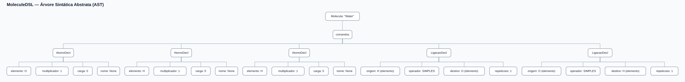

# Árvore Sintática Abstrata da MoleculeDSL

A AST é a representação própria da MoleculeDSL entre a árvore sintática do
ANTLR e o modelo semântico. Ela contém apenas os conceitos da linguagem,
sem nós de pontuação como `{`, `(` ou `)`. A análise semântica recebe a AST
e não acessa a parse tree do ANTLR.

Cada arquivo contém uma única espécie, conforme a decisão registrada em
`plano_sintatico.md`. O nome histórico da classe raiz continua `Molecula`
por compatibilidade; não há um nó `Programa` com uma lista de espécies.

## Estrutura dos nós

```text
Molecula
├── nome: str
├── tipo: TipoEspecie
├── carga_total: int | None
├── eletrons_desemparelhados: int | None
├── declaracao_legacy: bool
├── linha: int
├── coluna: int
└── comandos: list[Comando]
    ├── AtomoDecl
    │   ├── multiplicador: int
    │   ├── elemento: str
    │   ├── carga: int
    │   └── nome: str | None
    ├── LigacaoDecl
    │   ├── origem: Referencia
    │   ├── operador: Operador
    │   ├── destino: Referencia
    │   └── repeticoes: int
    ├── AnelDecl
    │   └── nomes: list[Referencia]
    └── EstereoDecl
        ├── referencias: list[Referencia]   (uma ou duas)
        ├── operador: Operador | None       (=, - ou nenhum)
        ├── descritor: str                  (R, S, r, s, E, Z, Ra, Sa, cis, trans)
        └── coluna_descritor: int
```

`TipoEspecie` distingue molécula, íon molecular, sólido iônico, rede
covalente e sólido metálico. `AtomoDecl`, `LigacaoDecl`, `AnelDecl`,
`EstereoDecl` e `Referencia` também guardam linha e
coluna. `TipoReferencia` distingue `ELEMENTO` de `NOME`, sem strings livres.
`Operador` é um enum com `SIMPLES`, `DUPLA`, `TRIPLA`, `COORDENADA` e
`METALICA`.

Quantificadores permanecem explícitos na AST: `4x atom H` produz um
`AtomoDecl` com `multiplicador=4`, e `bond C-H x4` produz um `LigacaoDecl`
com `repeticoes=4`. A expansão em átomos e ligações individuais pertence ao
modelo semântico.

## Mapeamento da gramática

| Regra da gramática | Resultado na AST |
|---|---|
| `programa` | encaminha o único nó `Molecula` |
| `molecula` | `Molecula` |
| `cabecalho` | tipo, nome e carga total de `Molecula` |
| `desemparelhados` | `eletrons_desemparelhados` de `Molecula` |
| `comando` | encaminha `AtomoDecl`, `LigacaoDecl`, `AnelDecl` ou `EstereoDecl` |
| `atomo` | `AtomoDecl` |
| `carga` | inteiro positivo ou negativo dentro de `AtomoDecl` |
| `ligacao` | `LigacaoDecl` |
| `referencia` | `Referencia` com `TipoReferencia` |
| `operador` | `Operador` |
| `anel` | `AnelDecl` |
| `estereo` | `EstereoDecl` |
| `descritor` | texto do descritor dentro de `EstereoDecl` |

O descritor fica como texto na AST: conferir se ele combina com o elemento
(R/S num centro, E/Z numa dupla) depende do grafo e pertence à semântica
(`STEREO-002`).

O visitor está em `src/construtor_ast.py`; as dataclasses e os enums ficam em
`src/ast_nos.py`.

## Exemplo: água

Entrada:

```text
species molecule "Water" {
    atom O
    atom H
    atom H

    bond H-O
    bond O-H
}
```

Saída de `python src/main.py --ast exemplos/agua.mol`:

```text
Molecula 'Water' tipo=molecule carga_total=+0 desemparelhados=não declarado [1:0]
  AtomoDecl elemento=O multiplicador=1 carga=+0 nome=None [2:4]
  AtomoDecl elemento=H multiplicador=1 carga=+0 nome=None [3:4]
  AtomoDecl elemento=H multiplicador=1 carga=+0 nome=None [4:4]
  LigacaoDecl SIMPLES repeticoes=1 [6:4]
    origem:  H (elemento) [6:9]
    destino: O (elemento) [6:11]
  LigacaoDecl SIMPLES repeticoes=1 [7:4]
    origem:  O (elemento) [7:9]
    destino: H (elemento) [7:11]
```

Versão visual gerada pelo projeto:



Há também uma referência com anel em
[ast-ciclopropano.svg](ast-ciclopropano.svg), a parse tree da água em
[arvore-sintatica-agua.svg](arvore-sintatica-agua.svg) e um exemplo com
configuração declarada (`stereo c1=c2 E`) em
[ast-dicloroeteno.svg](ast-dicloroeteno.svg) e
[arvore-sintatica-dicloroeteno.svg](arvore-sintatica-dicloroeteno.svg).

## Exemplo: configuração declarada

Trecho de `python src/main.py --ast exemplos/e_1_2_dicloroeteno.mol`:

```text
  EstereoDecl descritor=E operador=DUPLA [14:4]
    c1 (nome) [14:11]
    c2 (nome) [14:14]
```

## Testes

`testar.py` compara a saída textual de `--ast` com arquivos versionados para:

- água;
- amônio;
- ciclopropano;
- aminoborano;
- (E)-1,2-dicloroeteno, com `stereo`.

Para todos os exemplos de `exemplos/`, o caso `ast/todos_os_exemplos` confere
que cada comando do código vira exatamente um nó do tipo certo, na mesma
ordem, com linha e coluna, e que os multiplicadores continuam no nó.

O mesmo script gera, em uma pasta temporária, a parse tree e a AST em SVG de
todos os exemplos válidos e valida a estrutura básica de cada arquivo. O caso
`arvores/estereo_nas_arvores` confere que `EstereoDecl` aparece na AST e a
regra `estereo` na parse tree.
